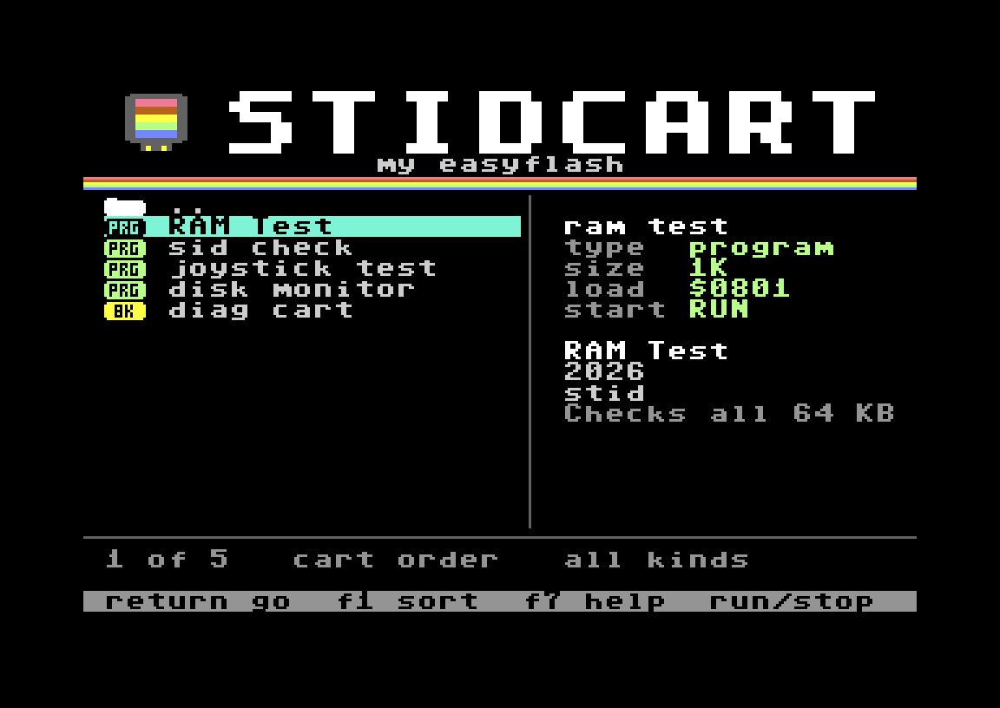
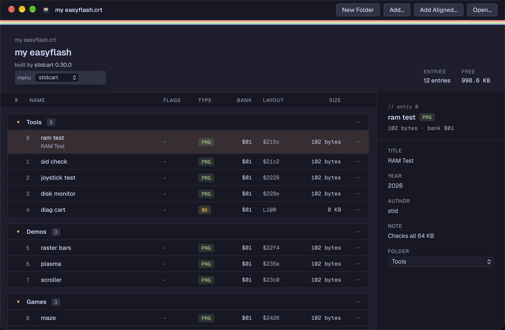
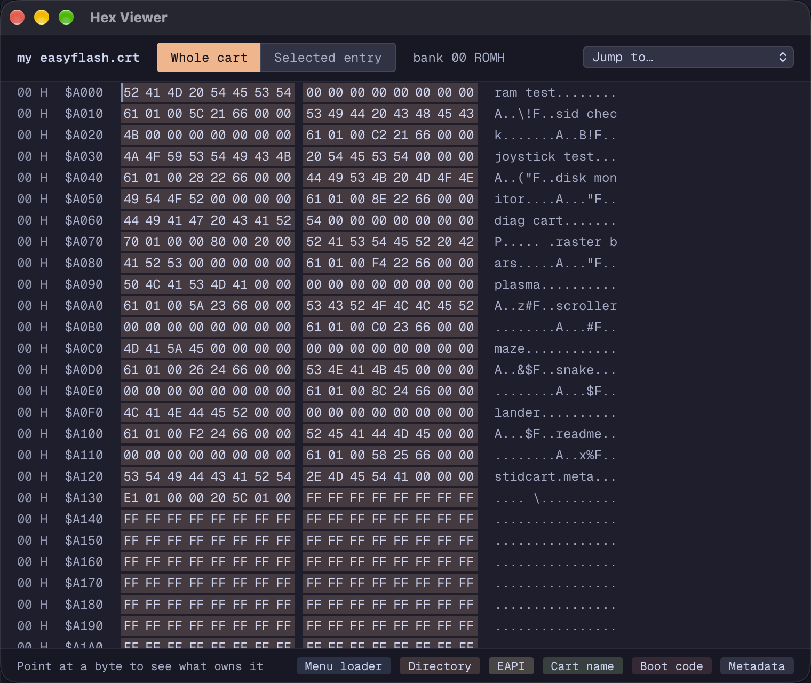

# stidcart

stidcart puts your programs and cartridge images on an EasyFlash cartridge for the Commodore 64.
It builds the `.crt` image, opens one you already have, and lets you add, remove, rename and
sort what is on it. It comes as a command-line tool and a desktop app, and it brings its own menu
for the C64 side. I use it with an EasyFlash 3.

On a Mac, install it with [Homebrew](https://brew.sh):

```bash
brew install --cask stid/tap/stidcart-app   # the desktop app
brew install stid/tap/stidcart              # the command-line tool
```

Windows, Linux, or a Mac without Homebrew: see [Installing](#installing).



*The menu, captured in VICE.*



*The desktop app, with the same cart open.*



*The app's hex viewer, at the cart's directory.*

## Why I wrote this

I have an EasyFlash 3 and a recent Mac, and every time I wanted to put a new set of programs on
the cartridge I lost an evening getting the existing tools to build and run. So I wrote my own,
just for me. It grew a desktop app and its own menu for the C64, and at some point it seemed
worth sharing. It is a hobby project, nothing commercial. If it saves another Commodore owner an
evening, that is all I want from it.

It is one small part of a wider hobby: I collect, repair and build vintage computers. There is
more about that, and my other projects, at [stid.me](https://stid.me).

## What it does

- Builds an EasyFlash image from `.prg` files and cartridge images: generic 8K, 16K and Ultimax,
  Ocean, and multi-bank EasyFlash cartridges. (A cart with an Ocean cartridge has to use
  EasyLoader.)
- Opens an existing EasyFlash image, including ones made with other tools, and shows what is on
  it and how much space is free.
- Edits a cart: add, remove, rename, replace, hide and reorder entries.
- Gives each entry a title, year, author and note, and sorts entries into folders.
- Lets you choose the menu the cart boots into: the stidcart menu, or EasyLoader, the menu
  EasyFlash carts have always used.
- Does all of this from the command line or in the app. Both write the same bytes.

The stidcart menu takes the keyboard or a joystick in port 2. It filters the list as you type,
sorts it A-Z, shows folders, and after a reset comes back to the entry you last started.

## Installing

The app and the command install separately, and each works without the other.

### macOS

With [Homebrew](https://brew.sh), from the project's own tap:

```bash
brew install --cask stid/tap/stidcart-app   # the desktop app
brew install stid/tap/stidcart              # the command-line tool
```

`brew upgrade` then follows new releases.

Without Homebrew, download `stidcart-…-macos-universal.dmg` from the
[latest release](https://github.com/stid/stidcart/releases/latest), open it and drag stidcart to
Applications. The command is `stidcart-cli-…-macos-universal.tar.gz` on the same page.

Either way the app and the command are signed and checked by Apple, so they open like any
downloaded app, on Intel or Apple silicon.

### Windows

Download `stidcart-…-windows-x86_64-setup.exe` from the
[latest release](https://github.com/stid/stidcart/releases/latest), for Windows 10 or 11, 64-bit.
The installer is not signed, so Windows shows "Windows protected your PC": choose "More info",
then "Run anyway". It installs for your user and asks for no administrator rights. The command is
`stidcart-cli-…-windows-x86_64.zip`.

### Linux

Download from the [latest release](https://github.com/stid/stidcart/releases/latest), for x86_64.
The `.deb` is for Ubuntu 22.04 or newer and Debian systems of that age, and brings in WebKitGTK.
The `.AppImage` runs elsewhere once you make it executable (`chmod +x`). Neither is signed. The
command is `stidcart-cli-…-linux-x86_64.tar.gz`.

### All downloads

| System | The app | The command |
|---|---|---|
| macOS, Intel or Apple silicon | `stidcart-…-macos-universal.dmg` | `stidcart-cli-…-macos-universal.tar.gz` |
| Windows 10 or 11, 64-bit | `stidcart-…-windows-x86_64-setup.exe` | `stidcart-cli-…-windows-x86_64.zip` |
| Linux, x86_64 | `stidcart-…-linux-x86_64.deb` or `.AppImage` | `stidcart-cli-…-linux-x86_64.tar.gz` |

A downloaded command is one file, `stidcart`. Unpack it and put it somewhere on your `PATH`.

`SHA256SUMS` on the release lists what each file should hash to.

I develop and use stidcart on a Mac. I have also run the app on Windows, on a real PC, and on an
Ubuntu desktop, and gone through my test list on both, and the command's tests run on Linux and
Windows in CI. I don't use either day to day, so if you run it there, I would like to hear how it
went.

### Building it yourself

You need [Rust](https://rustup.rs) installed through rustup, which picks up the compiler version
this repo pins. The desktop app also needs [Node](https://nodejs.org) 24.

```bash
git clone https://github.com/stid/stidcart.git
cd stidcart
```

On a Mac, one script builds the app into `/Applications` and installs the `stidcart` command:

```bash
scripts/install.sh
```

For the command alone, on any system:

```bash
cargo install --path crates/stidcart-cli --locked
```

[CONTRIBUTING.md](CONTRIBUTING.md) has what the app needs to build on Linux.

## Your first cart

```bash
stidcart build -e "my easyflash" -o my.crt game.prg demo.prg tool.crt
stidcart list my.crt
stidcart edit my.crt --add another.prg --folder 0 Games
```

`build` makes the image, `list` shows what is on it, and `edit` changes it in place. In the app,
choose New, drop your files on the window and save.

To put `my.crt` on the cartridge, copy it to an SD card or a disk and flash it with EasyProg, the
EasyFlash flashing program, on the C64. You can try it first in VICE:

```bash
x64sc -cartcrt my.crt
```

More detail:

- [The command line](docs/guide/cli.md): every command, and the file for setting many titles at
  once.
- [The desktop app](docs/guide/app.md).
- [The menu on the C64](docs/guide/menu.md): its keys, the joystick, folders, and the few
  programs it can't start.

## Status

This is a hobby project that I work on in my spare time. I use it for my own cartridge, and the
menu passed my full test list on a real EasyFlash 3 in a breadbin C64. The automated tests compare
the images it builds, byte for byte, with ones built by ndefpack, and boot the menu in VICE.

I haven't tested it on an original EasyFlash, and I can't promise support. Keep a copy of any
cart you care about before you edit it.

Bug reports, and reports of carts that do or don't work, are welcome as issues. I look at pull
requests when I have time; see [CONTRIBUTING.md](CONTRIBUTING.md).

## Credits and license

stidcart builds on other people's work:

- [ndefpack](https://ndefpack.sourceforge.net/) by Hannu Nuotio is where I learned the cart
  format. stidcart copies none of its code, but it was written from a description of the format
  taken from ndefpack's GPL sources, so I treat it as a derivative work and keep the same license.
- EasyFlash and EAPI are by Thomas 'skoe' Giesel. EasyLoader is by ALeX Kazik, in the version
  Hannu Nuotio altered for ndefpack. Every cart stidcart builds carries EAPI (the routines that write to the flash) and the boot code,
  and EasyLoader when you choose it. They are in `firmware/`, unchanged, under their own zlib
  license and with their source.

[CREDITS.md](CREDITS.md) has the full list. If I have missed someone or credited something
wrongly, please open an issue and I will fix it.

stidcart itself is GPL-2.0-or-later ([COPYING](COPYING)). The fonts bundled with the app are under
the SIL Open Font License 1.1.

## How it is made

Most of the code was written by Claude Code, an AI coding assistant. I set the direction, make the
decisions and test on real hardware. More on that, and how to build and test it, is in
[CONTRIBUTING.md](CONTRIBUTING.md). The cart format is written down in
[docs/format/easyflash-cart-format.md](docs/format/easyflash-cart-format.md).
