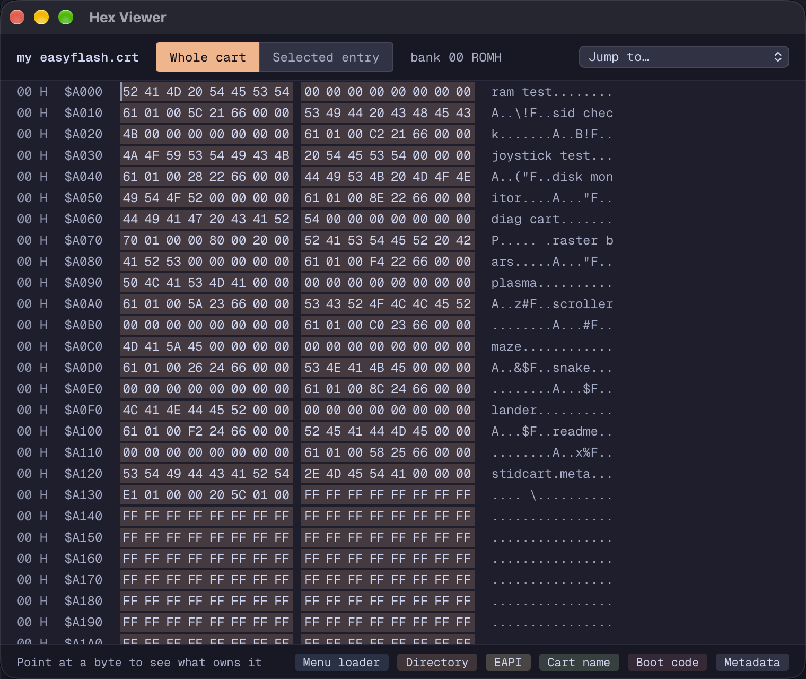

# The desktop app

The app builds and edits EasyFlash cartridge images in a window. It does what the `stidcart`
command does, and saves the same bytes. Installing it is in the
[README](../../README.md#installing).

The shortcuts here are the macOS ones. On Windows and Linux, Ctrl takes the place of ⌘.

## Your first cart

1. Choose New (⌘N). It starts an empty cart.
2. Drop your `.prg` files and cartridge images on the window, or use Add….
3. Click the cart name to change it. This is the name the menu shows on the C64.
4. Click an entry to give it a title, year, author and note, or to put it in a folder.
5. Save with ⌘S.

The cart boots into the stidcart menu unless you pick EasyLoader. To get the saved `.crt` onto
the cartridge, see the [README](../../README.md#your-first-cart).

## Opening a cart

Open a `.crt` with Open…, ⌘O or by dropping it on the window. The app shows the cart name, the
tool that made it, every entry and the free space. Sizes read in bytes, KB or MB; hover one to
see its exact byte count.

These are the values `stidcart list` prints. A file the app can't describe shows the reason, and
[Carts it won't open or edit](cli.md#carts-it-wont-open-or-edit) lists what those are.

## Adding and changing entries

- **Add:** drop programs or cartridge images on an open cart, or use Add…. What can go on a cart
  is in [What goes on a cart](cli.md#what-goes-on-a-cart).
- **Rename:** click an entry's name.
- **Replace, hide, remove:** use the entry's "⋯" button or right-click it. Replace… swaps the
  entry's data and keeps its name and place. A hidden entry stays on the cart, but neither menu
  lists it on the C64; Show brings it back.
- **Align:** Add Aligned… adds a multi-bank cartridge on a 64 KB boundary, and Align to 64 KB in
  an entry's menu does the same for one already on the cart. Use it if a cartridge doesn't start
  without it.
- **Names:** click the cart name or the header name to change either one.

## Titles and details

Click an entry to show it in the inspector beside the list: its number, name, kind and size, and
its title, year, author, note and folder. Click a field to change it, or pick its folder.

Each change is one edit that you can undo. A value that doesn't fit is refused with the reason;
the limits are in [Titles, details and folders](cli.md#titles-details-and-folders).

## The menu the cart boots into

The menu picker under the names chooses between the stidcart menu and EasyLoader.
[The menu on the C64](menu.md#the-stidcart-menu-or-easyloader) compares the two.

The stidcart menu can't run every cart: not one with an Ocean cartridge, and not one with a
program it [can't start](menu.md#what-it-can-start). The picker refuses the stidcart menu for
such a cart and names the entry.

## Folders

- New Folder adds an empty folder and opens its name for typing. It is in the title bar, under
  File (⇧⌘N), and on a right-click in the list's empty space.
- A folder's own menu renames, moves or deletes it. Deleting a folder moves its entries out of
  it; it never removes them from the cart.
- Once a cart has a folder, the list is drawn the way the stidcart menu shows it: each folder
  with its entries, then the entries in no folder.
- Drag an entry onto a folder to put it there, or between two rows to place it. Drag it to the
  strip at the bottom to take it out of its folder. An empty folder takes a drop too.
- Drag a folder row to move the whole folder.
- An entry's menu can do the same without dragging: Move to lists every folder, Not in a folder,
  and New Folder with Entry; Move up and Move down shift it one place.

The cart is saved in the order you see, so EasyLoader's flat list follows it too.

## Looking at the bytes

View ▸ Hex Viewer (⇧⌘H) opens a second window with the cart's bytes, 16 to a row. It only shows
them; nothing there can be changed.

- Rows run bank by bank, the low half (ROML) of each bank and then the high half (ROMH). Each row
  starts with its bank and half, then the address the C64 sees: `$8000` to `$9FFF` in ROML,
  `$A000` to `$BFFF` in ROMH. The top bar names the bank at the top of the view.
- The column on the right reads each byte as a character, the way names are stored, with `.` for
  anything that isn't one.
- Bytes are tinted by what they belong to: the menu loader, the directory, EAPI, the cart name
  and the boot code each have a colour (the key is at the bottom), and an entry's bytes wear the
  colour of its type badge. Untinted bytes are unused. Point at a byte to read its address and
  owner.
- Select an entry in the main window and the hex window moves to its first byte. An entry's menu
  has Show in Hex Viewer, and Jump to… in the hex window lists every owner.
- Whole cart / Selected entry at the top switches between the whole image and the bytes of the
  entry selected in the main window on their own. An entry's rows count from `$0000` at its
  first byte: a program reads as the file you added, load address first, and a cartridge bank
  by bank.
- The window shows the cart as it would be saved now, so it changes with every edit and undo.

## Saving

Changes stay in memory until you save:

- Undo and redo cover every edit since the cart was opened, and an "Edited" dot marks unsaved
  changes.
- ⌘S replaces the file and ⌘⇧S saves as. A saved cart is byte-identical to what `stidcart edit`
  or `stidcart build` writes for the same request.
- Closing, quitting, opening another cart or New asks first.

## Carts that open view-only

Some carts can be shown but not safely written back, such as one whose firmware differs from the
copy stidcart carries. The app opens such a cart view-only and gives the reason. These are the
carts `stidcart edit` refuses; see
[Carts it won't open or edit](cli.md#carts-it-wont-open-or-edit).

When the only reason is a menu stidcart doesn't know, the menu picker stays. Choosing a menu
there replaces the one on the cart and makes it editable.

---

See also: [the command line](cli.md) · [the menu on the C64](menu.md) ·
[README](../../README.md)
