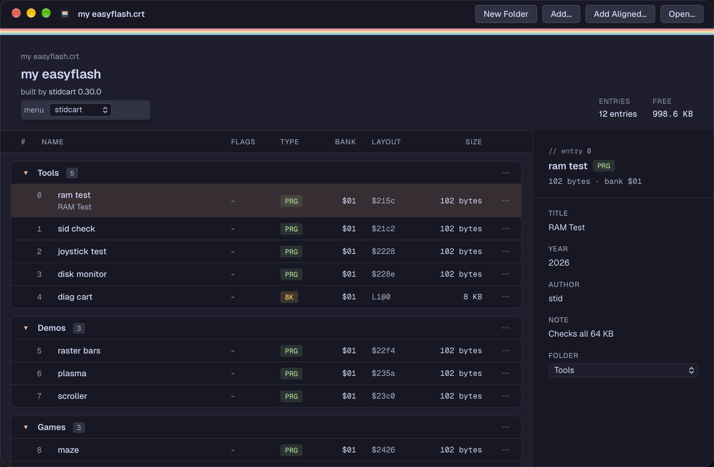

# The desktop app

The app does in a window what `stidcart edit` does on the command line, and saves the same bytes.
Installing it is in the [README](../../README.md#getting-it). The shortcuts here are the macOS ones.

## Using it

Open a `.crt` with Open…, ⌘O or by dropping it on the window. It shows the cart name, the
producing tool, every entry and the free space: the values `list` prints, from the same code. Sizes read in bytes, KB or MB; hover one to see its exact byte count. A file it
can't describe shows the same reason `list` gives.

The window edits what `edit` edits:
- Drop programs or cartridge images on an open cart, or use Add… / Add Aligned….
- Rename an entry by clicking its name. Its "⋯" or right-click menu replaces, hides or shows,
  aligns or removes it. A hidden entry stays on the cart but neither menu lists it; aligning
  places a multi-bank cartridge on a 64 KB boundary (see [cli.md](cli.md#what-goes-on-a-cart)).
- Click the cart name or the header name to change either one.
- Click an entry to show it in the inspector beside the list: its number, name, kind and size, and
  its title, year, author, note and folder. Click a field to change it, or pick its folder. Each
  change is one undoable edit, refused in `edit`'s words when invalid.
- Choose the menu the cart boots into, EasyLoader or stidcart, from the menu picker under the
  names. A cart the stidcart menu can't run (an Ocean entry, or a program it can't start; see
  [cli.md](cli.md)) refuses it and names the entry, as `edit --menu` does.
- New (⌘N) starts an empty cart.

## Folders

- New Folder adds an empty folder and opens its name for typing. It is in the title bar, under
  File (⇧⌘N), and on a right-click in the list's empty space.
- A folder's own menu renames, moves or deletes it. Deleting a folder moves its entries out of
  it; it never removes them from the cart.
- Once a cart has a folder, the list is drawn the way the stidcart menu shows it: each folder
  with its entries, then the entries in no folder.
- Drag an entry onto a folder to put it there, or between two rows to place it. Drag it to the
  strip at the bottom to take it out of its folder. An empty folder takes a drop too.
- Drag a folder row to move the whole folder.
- An entry's menu can do the same without dragging: Move to lists every folder, Not in a folder,
  and New Folder with Entry; Move up and Move down shift it one place.

The cart is saved in the order you see, so EasyLoader's flat list follows it too.

## Looking at the bytes

View ▸ Hex Viewer (⇧⌘H) opens a second window with the cart's bytes, 16 to a row. It only shows
them; nothing there can be changed.

- Rows run bank by bank, the low half (ROML) of each bank and then the high half (ROMH). Each row
  starts with its bank and half, then the address the C64 sees: `$8000` to `$9FFF` in ROML,
  `$A000` to `$BFFF` in ROMH. The top bar names the bank at the top of the view.
- The column on the right reads each byte as a character, the way names are stored, with `.` for
  anything that isn't one.
- Bytes are tinted by what they belong to: the menu loader, the directory, EAPI, the cart name
  and the boot code each have a colour (the key is at the bottom), and an entry's bytes wear the
  colour of its type badge. Untinted bytes are unused. Point at a byte to read its address and
  owner.
- Select an entry in the main window and the hex window moves to its first byte. An entry's menu
  has Show in Hex Viewer, and Jump to… in the hex window lists every owner.
- Whole cart / Selected entry at the top switches between the whole image and the bytes of the
  entry selected in the main window on their own. An entry's rows count from `$0000` at its
  first byte: a program reads as the file you added, load address first, and a cartridge bank
  by bank.
- The window shows the cart as it would be saved now, so it changes with every edit and undo.

## Saving

Changes stay in memory until you save:
- Undo and redo cover every edit since the cart was opened, and an "Edited" dot marks unsaved
  changes.
- ⌘S replaces the file and ⌘⇧S saves as. A saved cart is byte-identical to what `edit` or `build`
  writes for the same request.
- Closing, quitting, opening another cart or New asks first.

A cart `edit` refuses, such as firmware that differs from the embedded copy, opens view-only with
the reason. When the only reason is a loader the tool doesn't know, the menu picker stays: choosing
a menu replaces the loader and makes the cart editable.
