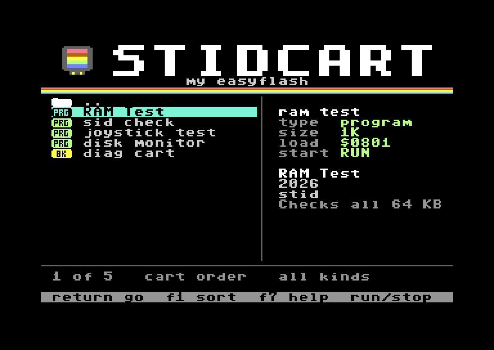

# The menu on the C64

A cart built by stidcart boots into this menu unless you choose EasyLoader. It lists the cart's
entries and starts the one you pick: a program, or a cartridge of any kind except Ocean. How it
works inside, and how to rebuild it, is in [menu/README.md](../../menu/README.md).

## Keys and joystick

| Key             | Does                                                                     |
| --------------- | ------------------------------------------------------------------------ |
| CRSR ↓ / CRSR ↑ | move the selection. The list scrolls past 16 rows                        |
| CRSR → / CRSR ← | move 16 entries down or up, stopping at the last or first                |
| RETURN          | start the selected entry, open the selected folder, or on `..` leave it  |
| SHIFT+RETURN    | load the selected program and stop at `READY.`; on a cartridge, nothing  |
| letters, digits | filter: list only the entries whose name or title contains the text      |
| DEL             | remove the last character of the filter text; with none, leave a folder  |
| HOME / CLR      | clear the filter text; with none, go to the first row / last entry       |
| F1              | switch between the cart's own order and A-Z                              |
| F3              | list all entries, then only programs, then only cartridges               |
| F5              | select a random entry among those listed, never the one already selected |
| F7              | show every key and the stick; the next key press goes back to the menu   |
| RUN/STOP        | leave a folder; at the top level, leave to BASIC with the cartridge off  |

A joystick in port 2 does what the cursor keys and RETURN do:

| Stick        | Does                                     |
| ------------ | ---------------------------------------- |
| up / down    | as CRSR ↑ / CRSR ↓, one entry            |
| left / right | as CRSR ← / CRSR →, a page               |
| fire         | as RETURN: start, open a folder, or `..` |
| any, on help | go back to the menu, and nothing else    |

A direction acts when it is pushed, and if it is held it repeats after 0.4 s, then ten times a
second. Fire acts once per press. Anything held when the menu starts does nothing until it is let
go, so a stick resting on fire doesn't start the first entry. The same goes for a direction that
closed the help screen. Port 1 isn't read, because its lines are shared with the keyboard.

The screen is black, with the stidcart logo at the top: the cartridge mark, its label in
five colour bands, sits left of a white block-letter logo, and a strip of the same five bands runs
under the cart name. The cart name sits above 16 list rows. Each
entry shows a badge for its kind, in the kind's colour: "PRG" for a program, "8K" and "16K" for
those cartridges, "ULT" for Ultimax, and "XB" for multi-bank. The selected entry sits in a cyan bar. When the list is longer than the screen, the divider to its right becomes a scroll bar: the
thumb's length is the share of the list in view, and its place is where the view is. The pane on the
right describes the selection: its type, size, load address (program) or first bank (cartridge),
and how it starts. Below the list are the position ("17 of 40"), the order in use and the kind
listed, then the filter text in yellow with the number listed out of the visible entries (inside a
folder, out of the folder's), then a grey bar naming the keys, `return go  f1 sort  f7 help  run/stop`. Hidden entries are not listed.
The filter and A-Z both ignore case. The filter takes up to 16 characters, any printable one except
`"`. A boot starts in the cart's own order, which is the order they were built in, with all
kinds listed, unless it comes back from a reset (see the last section). The kind filter (F3) combines with the
text, and changing either lists again from the first match.

A move that leaves the view (CRSR, a page, HOME/CLR, F5) scrolls only as far as it takes to show the
selection, so one page down from the top puts it on the last row. F5 mixes the CIA timer, the raster
line and the jiffy clock, which differ at every key press a person makes. The help screen keeps the
logo and the cart name and replaces rows 5-24; the key that ends it, RUN/STOP and RETURN included,
does nothing else.

A program that loads at or below `$0801` is started with `RUN`, and any other with `SYS` to its load
address. SHIFT+RETURN copies a program the same way and sets BASIC's pointers, but types nothing, so
`LIST`, `RUN` or a `SYS` work from `READY.`. Either way the program finds the C64's own colours and
upper-case character set, as after a reset.

A program can run from below `$D000` up to `$FFFF`. Its bytes from `$D000` on go into the RAM
under I/O and the KERNAL, not into the VIC, SID, CIAs or colour RAM as a KERNAL `LOAD` would put
them. The tool refuses to put this menu on a cart with an Ocean entry, or with a
program that the menu can't start:

- a program that loads at `$D000` or above, since the menu would start it inside I/O or the KERNAL
- a program that runs past `$FFFF`
- a program that reaches `$D000` and loads below `$0150`, over the routine that copies that part

EasyLoader itself won't start programs that reach `$D000`.
The tool doesn't check EasyLoader carts for any of this.

## Titles and folders

A cart can carry a title, year, author, note and folder for each entry, set with `edit --title`,
`--year`, `--author`, `--note`, `--folder` or `--import`, or in the desktop app. They are stored in a
hidden entry, `STIDCART.META`, which the menu reads once at boot.

- An entry with a title shows the title in its row instead of its name, cut to the row's 16
  characters. A-Z sorts by what the rows show.
- The pane shows the name, then the type, size and start facts on consecutive rows, then
  the title in full, the year, the author and the note. Each starts on a row of its own and wraps
  every 16 characters, so all of them fit at their longest. An entry with no title, year, author
  or note keeps the usual pane.
- The top level lists one row per folder that has a visible entry, with a folder badge, the
  folder's name and its number of entries, then the entries in no folder. An empty folder isn't
  listed. RETURN or
  fire opens a folder, with its first entry selected. Inside, the keys act on the folder's entries,
  and DEL with no text or RUN/STOP goes back to the top level with the folder selected. A name too
  long for the row is cut to leave room for the count.
- Inside a folder the first row is `..`, with the folder badge. RETURN or fire on it goes back to
  the top level as DEL and RUN/STOP do, so the joystick can leave a folder. It stays first
  under A-Z, the kind filter and filter text, even when nothing matches. It isn't an entry: rows
  22-23 don't count it, so on it the position reads 0, F5 never picks it, and a reset never comes
  back to it. HOME selects it and CLR the last entry.
- Text typed at the top level searches every entry, in every folder, by name or title, and lists
  the matches without folders.
- Folder rows ignore the kind filter and stay in the cart's own folder order, also under A-Z. You
  set that order in the app or with `edit --move-folder`.

A cart whose metadata the menu can't use boots as a cart without any: no `STIDCART.META` entry, one
whose payload doesn't start with the magic, a layout version other than 1, a payload over 16 KB, or
a record that runs past the end. A record whose stored name differs from its entry's is ignored, so
a cart re-ordered by another tool shows names, not wrong titles.

## Coming back after a reset

After a soft reset the menu comes back where it was left: the entry last started, or the one
selected at RUN/STOP, is selected and in view, in the same order and kind filter. An entry in a
folder comes back inside that folder, wherever it was started from. The filter text isn't kept.
RUN/STOP with a folder row selected leaves nothing to come back to, so the next boot starts at the
top. If the kind filter would hide that entry, all kinds are listed. A power cycle starts at
the top, and so does a reset after a program that wrote the menu's state (an EAPI or xbank game
may). The state is checked before it is used, so state that was damaged or written for another cart
starts at the top too. This works in VICE and with an
EasyFlash 3's own RESET button on a real C64.
